# ÉTAPE 1 — Observer : les métriques indispensables

> **Objectif :** transformer les images des caméras en informations minimales nécessaires à la **décision locale**, à la **communication avec les carrefours voisins** et à **l'évaluation de chaque décision**.  
> **Portée :** définition des données uniquement. Cette étape ne commande aucun feu.

## Configuration : chaque voie est divisée en trois zones

- **Zone 1** : proche de la ligne d'arrêt / du feu.
- **Zone 2** : portion intermédiaire de la voie.
- **Zone 3** : portion amont (véhicules qui approchent).
- Identifier chaque voie et sa **direction / son mouvement** (tout droit, gauche, etc.) ainsi que le carrefour concerné.

Les zones sont des polygones calibrés pour **chaque caméra**. Les nombres de véhicules doivent être comptés sans double comptage si des zones se chevauchent.

## A. AVANT LA DÉCISION — mesures nécessaires par voie et mouvement

| Nom proposé | Métrique | Unité | Pourquoi |
| --- | --- | --- | --- |
| `zone_1_count`, `zone_2_count`, `zone_3_count` | Nombre de véhicules présents dans chacune des trois zones | véhicules | Distinguer les véhicules proches du feu et ceux qui approchent |
| `queue_count` | Nombre de véhicules dans la file à l'arrêt ou presque | véhicules | Mesurer la demande qui attend réellement le passage |
| `mean_wait_s` | Temps d'attente moyen des véhicules de cette file | secondes | Éviter qu'une voie attende excessivement |
| `occupancy_ratio` | Part de la voie occupée / saturation observée | 0 à 1 | Reconnaître une voie saturée et risquant un blocage |
| `arrival_count_30s` | Véhicules arrivés à l'approche pendant les 30 dernières secondes | véhicules/30 s | Observer les changements de demande |

**Contexte du contrôleur (indispensable, mais non fourni par la caméra) :** `active_phase` et `phase_elapsed_s`. Ce sont des données du feu, nécessaires pour choisir une prochaine phase autorisée dans le respect de son protocole de sécurité. Les durées verte, jaune et tout-rouge sont gérées par ce protocole, pas déduites des pixels.

### Illustrations des métriques

Les valeurs représentées sont **fictives** : elles servent uniquement à visualiser chaque indicateur. Les schémas ne constituent ni une détection réelle ni un résultat expérimental.

#### Véhicules par zone (1, 2, 3)

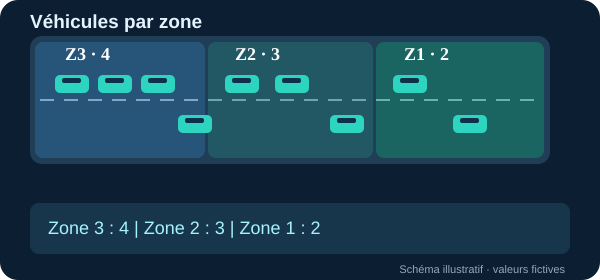

#### File à l'arrêt

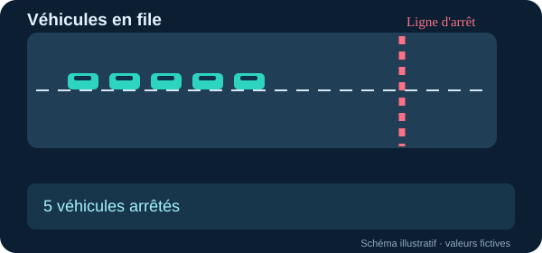

#### Temps d'attente moyen

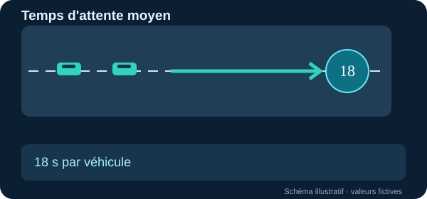

#### Occupation de la voie

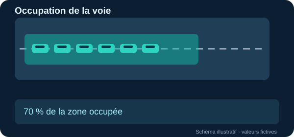

#### Arrivées en 30 secondes

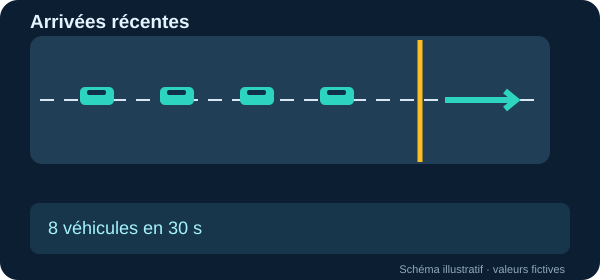

#### Phase active

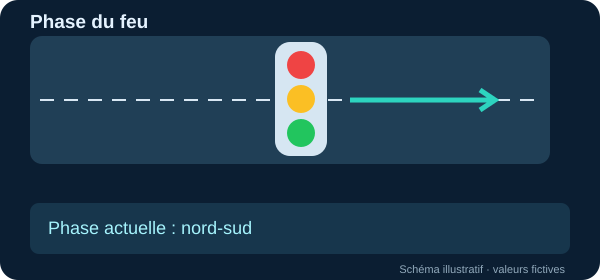

#### Temps écoulé de la phase

## B. COMMUNICATION ENTRE INTERSECTIONS — message minimal

À destination des carrefours reliés par une voie :

| Nom proposé | Métrique | Unité | Pourquoi |
| --- | --- | --- | --- |
| `outgoing_count_30s` | Nombre de véhicules sortis vers la voie/intersection voisine durant la fenêtre récente | véhicules/30 s | Annoncer le flux libéré par l'amont |
| `destination_movement_id` | Direction / voie de destination du flux | identifiant | Avertir **le bon mouvement** aval |
| `estimated_arrival_s` | Temps estimé avant l'arrivée du flux | secondes | Permettre au carrefour suivant d'anticiper |
| `downstream_queue_count` | File présente sur la voie de réception (observation du voisin) | véhicules | Savoir si le passage est déjà encombré |
| `downstream_available_storage` | Nombre **estimé** de places encore disponibles sur la voie de réception | véhicules | Limiter les décisions susceptibles de déclencher une remontée de file |
| `observed_at` | Horodatage de la dernière observation | horodatage | Ne pas prendre de décision sur des informations périmées |

Les trois premières données proviennent de l'intersection **amont** ; les suivantes de l'intersection **aval**. L'horodatage accompagne tous les messages.

**Important :** le nombre sorti et sa destination peuvent être construits par suivi des véhicules dans des zones d'entrée et de sortie. Le temps d'arrivée demande une estimation du trajet. La capacité libre en aval demande une mesure ou calibration supplémentaire de la longueur utile, des véhicules et de la file : **Supervision ne la fournit pas directement**.

### Illustrations des métriques

Les valeurs représentées sont **fictives** : elles servent uniquement à visualiser chaque indicateur. Les schémas ne constituent ni une détection réelle ni un résultat expérimental.

#### Véhicules sortants

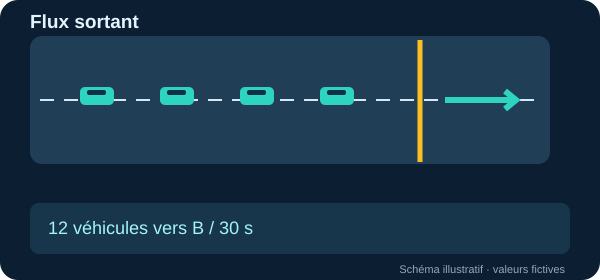

#### Mouvement de destination

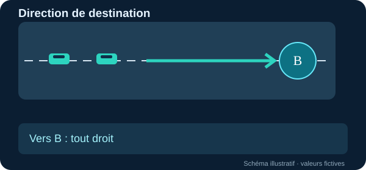

#### Arrivée estimée chez le voisin

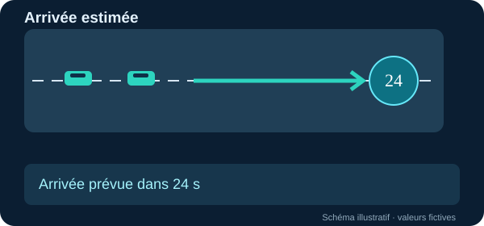

#### File d'attente en aval

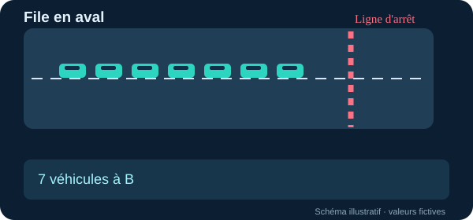

#### Places libres en aval

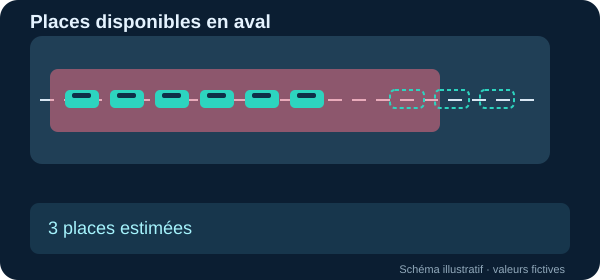

#### Horodatage de l'observation

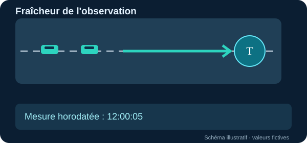

## C. APRÈS LA DÉCISION — évaluer son effet

Conserver aussi l'`action_phase`, la `green_duration_s` et les heures de début/fin de l'action, pour rattacher les mesures à la bonne décision.

| Nom proposé | Mesure | Unité | Sens de l'amélioration |
| --- | --- | --- | --- |
| `mean_wait_s` | Attente moyenne des véhicules, sur la fenêtre d'évaluation | s/véhicule | Plus bas |
| `mean_queue_count` | Moyenne temporelle des files par voie, puis agrégation au carrefour | véhicules | Plus bas |
| `throughput_count` | Véhicules ayant effectivement franchi la ligne de sortie | véhicules/fenêtre | Plus haut, à demande comparable |
| `spillback_events` | Nombre d'épisodes où la file atteint l'amont et risque de bloquer l'intersection précédente | événements/fenêtre | Plus bas |

**Comparer avant et après :** utiliser des fenêtres et une demande comparables, mais aussi observer plusieurs décisions consécutives. Les métriques d'attente et de file varient naturellement au cours d'un cycle ; une baisse ponctuelle ne prouve pas que le contrôle est meilleur. Pour attribuer une amélioration au système, comparer également avec des feux fixes et des contrôleurs adaptatifs de référence sur des conditions identiques.

### Illustrations des métriques

Les valeurs représentées sont **fictives** : elles servent uniquement à visualiser chaque indicateur. Les schémas ne constituent ni une détection réelle ni un résultat expérimental.

#### Phase effectivement commandée

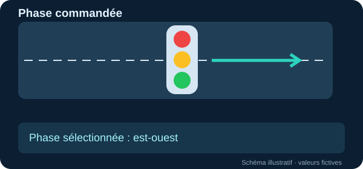

#### Durée verte appliquée

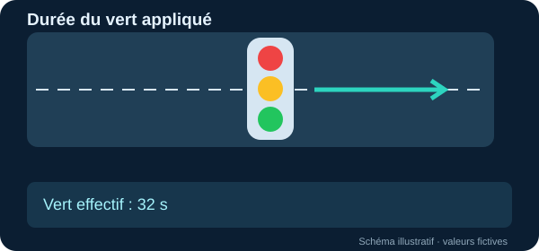

#### Attente moyenne après la décision

#### File moyenne

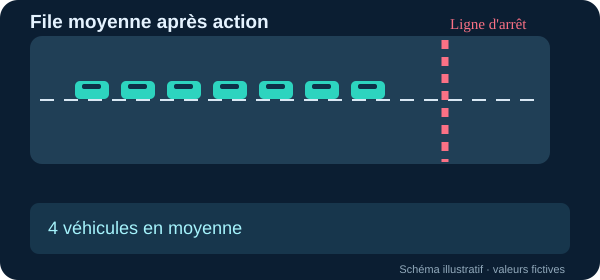

#### Véhicules servis

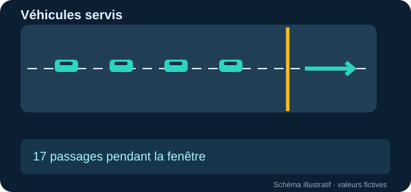

#### Remontées de file

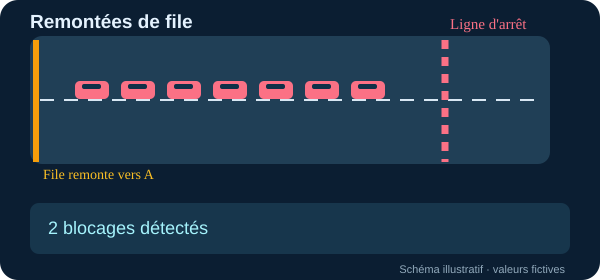

## Lien exact avec les quatre exemples Roboflow analysés

| Exemple étudié | Ce qu'il permet réellement | Ce qu'il ne fournit pas directement |
| --- | --- | --- |
| [Count Objects Crossing the Line](https://supervision.roboflow.com/latest/notebooks/count-objects-crossing-the-line/#define-line-position) | `sv.LineZone`, suivi des véhicules, franchissements `in_count` et `out_count` | Temps d'attente, capacité aval, effets de la décision |
| [Traffic Analysis](https://github.com/roboflow/supervision/blob/develop/examples/traffic_analysis/ultralytics_example.py) | Polygones d'entrée/sortie, suivi par `tracker_id`, comptage des trajets entrée → sortie | Temps futur d'arrivée, congestion prédite |
| [Count People in Zone](https://github.com/roboflow/supervision/blob/develop/examples/count_people_in_zone/ultralytics_example.py) | `sv.PolygonZone` et nombre d'objets présents dans un polygone ; **à adapter aux classes véhicules** | Une file de véhicules arrêtés, la durée d'arrêt |
| [Time in Zone](https://github.com/roboflow/supervision/blob/develop/examples/time_in_zone/ultralytics_stream_example.py) | `ClockBasedTimer` et durée passée dans une zone pour chaque véhicule suivi | Temps d'attente *à l'arrêt* sans calcul supplémentaire de mouvement/vitesse |

### Calculs à implémenter au-dessus de la détection

1. **File et attente :** identifier les véhicules immobiles ou presque (déplacement suivi, seuil calibré, durée minimale), puis accumuler le temps passé **à l'arrêt**. Le simple temps dans un polygone est insuffisant.
2. **Occupation et capacité libre :** calibrer les zones en unités physiques, estimer leur occupation et la place restante ; ne pas assimiler directement un comptage de véhicules à une occupation en pourcentage.
3. **Arrivées et sorties :** compter les identifiants suivis franchissant les lignes pendant une fenêtre glissante de **30 secondes** ; les cumuls depuis le début d'une vidéo ne sont pas des débits.
4. **Remontée de file :** détecter la présence persistante d'une file au bord amont de la portion routière, avec un critère temporel, afin de ne pas confondre une occupation temporaire avec un blocage.

### Périmètre minimal retenu

**Avant :** 3 comptes de zones + file + attente + occupation + arrivées + état du feu.  
**Entre voisins :** flux sorti + destination + temps d'arrivée estimé + file aval + capacité libre aval + horodatage.  
**Après :** attente + file moyenne + véhicules servis + épisodes de blocage aval.

Ce document est une **spécification de métriques pour Tricolor AI**, fondée sur les capacités vérifiées des exemples Supervision. Les mesures dérivées ou prédites ne sont pas présentées comme des sorties directes de ces exemples.
