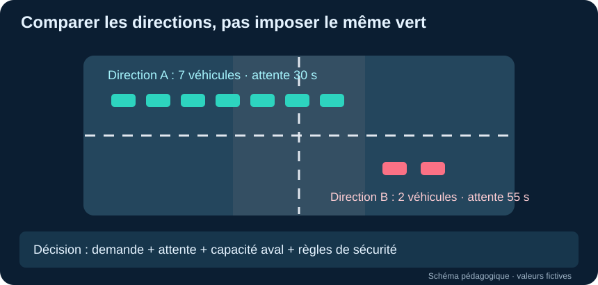

# ÉTAPE 1 — Observer : les métriques indispensables

> **Objectif :** transformer les images des caméras en informations minimales nécessaires à la **décision locale**, à la **communication avec les carrefours voisins** et à **l'évaluation de chaque décision**.  
> **Portée :** définition des données uniquement. Cette étape ne commande aucun feu.

## Configuration : chaque voie est divisée en trois zones

- **Zone 1** : proche de la ligne d'arrêt / du feu.
- **Zone 2** : portion intermédiaire de la voie.
- **Zone 3** : portion amont (véhicules qui approchent).
- Identifier chaque voie et sa **direction / son mouvement** (tout droit, gauche, etc.) ainsi que le carrefour concerné.

Les zones sont des polygones calibrés pour **chaque caméra**. Les nombres de véhicules doivent être comptés sans double comptage si des zones se chevauchent.

## A. AVANT LA DÉCISION — mesures nécessaires par voie et mouvement

| Nom proposé | Métrique | Unité | Pourquoi |
| --- | --- | --- | --- |
| `zone_1_count`, `zone_2_count`, `zone_3_count` | Nombre de véhicules présents dans chacune des trois zones | véhicules | Distinguer les véhicules proches du feu et ceux qui approchent |
| `queue_count` | Nombre de véhicules dans la file à l'arrêt ou presque | véhicules | Mesurer la demande qui attend réellement le passage |
| `mean_wait_s` | Temps d'attente moyen des véhicules de cette file | secondes | Éviter qu'une voie attende excessivement |
| `occupancy_ratio` | Part de la voie occupée / saturation observée | 0 à 1 | Reconnaître une voie saturée et risquant un blocage |
| `arrival_count_30s` | Véhicules arrivés à l'approche pendant les 30 dernières secondes | véhicules/30 s | Observer les changements de demande |

**Contexte du contrôleur (indispensable, mais non fourni par la caméra) :** `active_phase` et `phase_elapsed_s`. Ce sont des données du feu, nécessaires pour choisir une prochaine phase autorisée dans le respect de son protocole de sécurité. Les durées verte, jaune et tout-rouge sont gérées par ce protocole, pas déduites des pixels.

### Illustrations des métriques

Les valeurs représentées sont **fictives** : elles servent uniquement à visualiser chaque indicateur. Les schémas ne constituent ni une détection réelle ni un résultat expérimental.

#### Véhicules par zone (1, 2, 3)

**Pourquoi mesurer cette information et comment elle influence la décision.** Les trois zones montrent **où se concentrent les véhicules sur une même approche** : la zone 1 est proche du feu, la zone 2 au milieu et la zone 3 plus loin en amont. Cette répartition est plus informative qu'un seul total : une zone 1 remplie indique une demande immédiate, tandis qu'une zone 3 qui se remplit annonce l'arrivée d'une nouvelle vague. **Conséquence pour la décision :** le contrôleur peut distinguer une file déjà formée d'un trafic qui approche et éviter de prolonger un vert simplement parce que des véhicules sont visibles au loin. Les comptes doivent être associés à une voie et à un mouvement précis.

#### File à l'arrêt

**Pourquoi mesurer cette information et comment elle influence la décision.** Cette illustration isole les véhicules **réellement arrêtés ou presque arrêtés dans une file**, plutôt que tous les véhicules présents dans l'image. C'est essentiel, car une voie peut contenir plusieurs voitures qui circulent normalement sans nécessiter de vert supplémentaire. **Conséquence :** une file persistante signale une demande non satisfaite et peut justifier de servir la direction concernée, sous réserve de la sécurité et de l'état des autres voies. Le comptage exige de suivre le mouvement des véhicules et de définir un seuil d'arrêt.

#### Temps d'attente moyen

**Pourquoi mesurer cette information et comment elle influence la décision.** Le temps d'attente moyen exprime **combien de secondes les véhicules de la file ont passé à l'arrêt**. Deux voies comportant le même nombre de voitures ne sont pas équivalentes si l'une attend depuis quelques secondes et l'autre depuis longtemps. **Conséquence :** cette métrique permet de limiter les attentes excessives et d'éviter qu'une direction peu fréquentée soit oubliée. Elle doit mesurer l'immobilité observée, pas seulement le temps de présence dans un polygone ; les véhicules quittant la scène doivent être traités de façon cohérente.

#### Occupation de la voie

**Pourquoi mesurer cette information et comment elle influence la décision.** L'occupation indique **quelle part de l'espace utile de la voie est déjà prise** par des véhicules. Elle complète le nombre de voitures : cinq véhicules longs n'occupent pas la même place que cinq petites voitures. **Conséquence :** si la voie est proche de la saturation, il peut devenir dangereux de lui envoyer davantage de véhicules, même lorsque le feu amont souhaite les libérer. Cette proportion doit être estimée après calibration de la zone ; elle ne se déduit pas directement d'un simple nombre de détections.

#### Arrivées en 30 secondes

**Pourquoi mesurer cette information et comment elle influence la décision.** Le nombre d'arrivées sur une fenêtre récente de 30 secondes montre **la demande nouvelle qui entre dans l'approche**, indépendamment des voitures déjà présentes. Il révèle les vagues de véhicules qui se forment après l'ouverture d'un feu voisin. **Conséquence :** une hausse des arrivées peut aider à préparer le prochain service, tandis qu'une baisse évite de maintenir inutilement un vert. Il faut compter les franchissements uniques d'une ligne virtuelle, et non additionner les véhicules visibles à chaque image.

#### Phase active

**Pourquoi mesurer cette information et comment elle influence la décision.** La phase active indique **quels mouvements ont actuellement l'autorisation de passer**. C'est une donnée du contrôleur de feux, non une mesure que l'on devrait deviner uniquement à partir de la caméra. **Conséquence :** le système sait s'il doit maintenir une phase autorisée ou envisager une transition vers une autre direction. Toute transition doit respecter les conflits de mouvements, les piétons et les temps de sécurité imposés par l'installation.

#### Temps écoulé de la phase

**Pourquoi mesurer cette information et comment elle influence la décision.** Cette métrique mesure **depuis combien de secondes la phase actuelle fonctionne**. Elle évite de prendre une décision sans connaître le temps de vert déjà accordé. **Conséquence :** le système peut vérifier les durées minimales et maximales configurées avant de prolonger ou de terminer une phase. Un carrefour très chargé ne doit pas changer de feu de manière brusque ou excessive ; la mesure vient de l'horloge du contrôleur.

## B. COMMUNICATION ENTRE INTERSECTIONS — message minimal

À destination des carrefours reliés par une voie :

| Nom proposé | Métrique | Unité | Pourquoi |
| --- | --- | --- | --- |
| `outgoing_count_30s` | Nombre de véhicules sortis vers la voie/intersection voisine durant la fenêtre récente | véhicules/30 s | Annoncer le flux libéré par l'amont |
| `destination_movement_id` | Direction / voie de destination du flux | identifiant | Avertir **le bon mouvement** aval |
| `estimated_arrival_s` | Temps estimé avant l'arrivée du flux | secondes | Permettre au carrefour suivant d'anticiper |
| `downstream_queue_count` | File présente sur la voie de réception (observation du voisin) | véhicules | Savoir si le passage est déjà encombré |
| `downstream_available_storage` | Nombre **estimé** de places encore disponibles sur la voie de réception | véhicules | Limiter les décisions susceptibles de déclencher une remontée de file |
| `observed_at` | Horodatage de la dernière observation | horodatage | Ne pas prendre de décision sur des informations périmées |

Les trois premières données proviennent de l'intersection **amont** ; les suivantes de l'intersection **aval**. L'horodatage accompagne tous les messages.

**Important :** le nombre sorti et sa destination peuvent être construits par suivi des véhicules dans des zones d'entrée et de sortie. Le temps d'arrivée demande une estimation du trajet. La capacité libre en aval demande une mesure ou calibration supplémentaire de la longueur utile, des véhicules et de la file : **Supervision ne la fournit pas directement**.

### Illustrations des métriques

Les valeurs représentées sont **fictives** : elles servent uniquement à visualiser chaque indicateur. Les schémas ne constituent ni une détection réelle ni un résultat expérimental.

#### Véhicules sortants

**Pourquoi mesurer cette information et comment elle influence la décision.** Le flux sortant correspond au **nombre de véhicules ayant réellement quitté le carrefour vers une liaison précise** pendant les 30 dernières secondes. Contrairement à une file observée avant le feu, ce comptage représente le trafic effectivement libéré. **Conséquence :** le carrefour suivant peut se préparer à recevoir cette vague et vérifier s'il dispose de suffisamment d'espace. Il faut compter les franchissements et identifier leur direction ; le cumul depuis le début d'une vidéo n'est pas un débit récent.

#### Mouvement de destination

**Pourquoi mesurer cette information et comment elle influence la décision.** Cette information désigne **la voie ou le mouvement vers lequel les véhicules se dirigent** : tout droit, à gauche, à droite ou vers une liaison donnée. Un carrefour peut envoyer dix véhicules dans plusieurs directions ; avertir tous les voisins avec un seul total serait trompeur. **Conséquence :** chaque voisin reçoit l'information correspondant à la route qu'il devra effectivement gérer, ce qui évite d'ouvrir inutilement une direction non concernée. L'identification repose sur la géométrie routière et le suivi des trajectoires.

#### Arrivée estimée chez le voisin

**Pourquoi mesurer cette information et comment elle influence la décision.** Le temps d'arrivée estimé représente **le délai probable avant qu'un groupe de véhicules libérés en amont atteigne le carrefour suivant**. Il dépend de la distance, de la vitesse et des conditions de circulation. **Conséquence :** le voisin peut anticiper la demande au lieu d'attendre que la file se forme devant son feu. Cette valeur est une estimation incertaine, pas une mesure directement fournie par Roboflow ; elle doit être recalculée lorsque la circulation ralentit.

#### File d'attente en aval

**Pourquoi mesurer cette information et comment elle influence la décision.** La file en aval décrit **les véhicules déjà en attente sur la voie qui recevra le flux du carrefour précédent**. Elle est indispensable pour distinguer un feu localement efficace d'une décision qui crée un problème chez le voisin. **Conséquence :** si l'aval est déjà encombré, le carrefour amont peut limiter l'envoi de nouveaux véhicules plutôt que déplacer son embouteillage. Cette mesure doit être communiquée par le carrefour aval avec son horodatage.

#### Places libres en aval

**Pourquoi mesurer cette information et comment elle influence la décision.** La capacité disponible en aval estime **combien de véhicules supplémentaires peuvent encore être accueillis sur la liaison**, sans bloquer la sortie du carrefour amont. Une route avec une petite file peut malgré tout manquer de place si elle est courte. **Conséquence :** cette métrique sert à prévenir les remontées de congestion en évitant de libérer plus de trafic que la liaison ne peut absorber. Il s'agit d'une estimation dépendant de la longueur utile, de l'occupation et des tailles des véhicules, pas d'une sortie directe du détecteur.

#### Horodatage de l'observation

**Pourquoi mesurer cette information et comment elle influence la décision.** L'horodatage indique **à quel instant chaque mesure a été produite**. Une file de trois véhicules observée il y a vingt secondes peut déjà avoir disparu ou doublé. **Conséquence :** le système peut refuser d'utiliser une information trop ancienne et revenir à un comportement sûr lorsque la communication est interrompue. L'horloge des carrefours doit être synchronisée et la durée de validité des messages définie.

## C. APRÈS LA DÉCISION — évaluer son effet

Conserver aussi l'`action_phase`, la `green_duration_s` et les heures de début/fin de l'action, pour rattacher les mesures à la bonne décision.

| Nom proposé | Mesure | Unité | Sens de l'amélioration |
| --- | --- | --- | --- |
| `mean_wait_s` | Attente moyenne des véhicules, sur la fenêtre d'évaluation | s/véhicule | Plus bas |
| `mean_queue_count` | Moyenne temporelle des files par voie, puis agrégation au carrefour | véhicules | Plus bas |
| `throughput_count` | Véhicules ayant effectivement franchi la ligne de sortie | véhicules/fenêtre | Plus haut, à demande comparable |
| `spillback_events` | Nombre d'épisodes où la file atteint l'amont et risque de bloquer l'intersection précédente | événements/fenêtre | Plus bas |

**Comparer avant et après :** utiliser des fenêtres et une demande comparables, mais aussi observer plusieurs décisions consécutives. Les métriques d'attente et de file varient naturellement au cours d'un cycle ; une baisse ponctuelle ne prouve pas que le contrôle est meilleur. Pour attribuer une amélioration au système, comparer également avec des feux fixes et des contrôleurs adaptatifs de référence sur des conditions identiques.

### Illustrations des métriques

Les valeurs représentées sont **fictives** : elles servent uniquement à visualiser chaque indicateur. Les schémas ne constituent ni une détection réelle ni un résultat expérimental.

#### Phase effectivement commandée

**Pourquoi mesurer cette information et comment elle influence la décision.** La phase commandée conserve **la décision réellement envoyée au contrôleur** à un instant donné. Elle doit être distinguée de la phase observée avant la décision : une demande de changement peut ne pas être immédiatement exécutée à cause des transitions de sécurité. **Conséquence pour l'évaluation :** on peut relier les variations de file et d'attente à la bonne action, détecter des décisions non appliquées et comparer plusieurs stratégies de contrôle.

#### Durée verte appliquée

**Pourquoi mesurer cette information et comment elle influence la décision.** La durée du vert appliqué indique **combien de temps les mouvements concernés ont effectivement été servis**. Une longue durée peut écouler une file importante, mais elle peut aussi augmenter l'attente des directions opposées. **Conséquence :** cette donnée permet d'examiner si le temps accordé était proportionné à la demande et de comparer les effets de durées différentes, toujours dans les limites de sécurité du contrôleur.

#### Attente moyenne après la décision

**Pourquoi mesurer cette information et comment elle influence la décision.** Le temps d'attente moyen exprime **combien de secondes les véhicules de la file ont passé à l'arrêt**. Deux voies comportant le même nombre de voitures ne sont pas équivalentes si l'une attend depuis quelques secondes et l'autre depuis longtemps. **Conséquence :** cette métrique permet de limiter les attentes excessives et d'éviter qu'une direction peu fréquentée soit oubliée. Elle doit mesurer l'immobilité observée, pas seulement le temps de présence dans un polygone ; les véhicules quittant la scène doivent être traités de façon cohérente.

#### File moyenne

**Pourquoi mesurer cette information et comment elle influence la décision.** La file moyenne est calculée **à partir de plusieurs observations successives**, sur une fenêtre définie après la décision. Elle est plus robuste qu'une seule image prise juste après le passage au vert. **Conséquence :** elle montre si la décision réduit durablement les files ou si celles-ci réapparaissent aussitôt. Les comparaisons doivent utiliser la même durée d'observation et tenir compte de la demande entrante.

#### Véhicules servis

**Pourquoi mesurer cette information et comment elle influence la décision.** Le nombre de véhicules servis compte **ceux qui ont effectivement franchi la sortie du carrefour** durant la période évaluée. Une baisse de file n'est pas toujours un succès si les véhicules ont simplement changé de voie ou quitté la zone d'observation. **Conséquence :** cette mesure vérifie que la décision a réellement permis le passage. Un débit plus élevé n'est bénéfique que si l'aval peut recevoir les véhicules et si la sécurité est respectée.

#### Remontées de file

**Pourquoi mesurer cette information et comment elle influence la décision.** Une remontée de file se produit lorsque **la congestion atteint l'extrémité amont d'une liaison** et menace de bloquer un autre carrefour. L'illustration montre pourquoi une décision localement efficace peut dégrader le réseau entier. **Conséquence :** ces événements constituent un indicateur prioritaire pour juger la coordination : leur multiplication signifie que les feux déplacent la congestion au lieu de la résoudre. La détection doit exiger une occupation persistante, et non un simple véhicule de passage.

## Lecture équilibrée des directions — pourquoi comparer les voies ?

**Pourquoi cette illustration ?** Le système doit observer les différentes directions selon des règles comparables, sans supposer qu'elles reçoivent toutes le même nombre de véhicules ou qu'elles doivent obtenir exactement la même durée de vert. Ici, la **symétrie** signifie une **comparaison équitable et cohérente des mesures** : mêmes unités, mêmes fenêtres temporelles et prise en compte des files et des attentes de chaque mouvement. Une direction très chargée peut nécessiter davantage de temps, tandis qu'une direction peu chargée ne doit pas être abandonnée indéfiniment. **Conséquence pour la décision :** le contrôleur doit rechercher un équilibre entre réduction de la congestion, attente maximale acceptable et sécurité, tout en tenant compte de la capacité des voies en aval. L'équilibre n'est donc **pas** un partage 50/50 du temps vert : c'est une décision proportionnée à la situation réelle.

## Lien exact avec les quatre exemples Roboflow analysés

| Exemple étudié | Ce qu'il permet réellement | Ce qu'il ne fournit pas directement |
| --- | --- | --- |
| [Count Objects Crossing the Line](https://supervision.roboflow.com/latest/notebooks/count-objects-crossing-the-line/#define-line-position) | `sv.LineZone`, suivi des véhicules, franchissements `in_count` et `out_count` | Temps d'attente, capacité aval, effets de la décision |
| [Traffic Analysis](https://github.com/roboflow/supervision/blob/develop/examples/traffic_analysis/ultralytics_example.py) | Polygones d'entrée/sortie, suivi par `tracker_id`, comptage des trajets entrée → sortie | Temps futur d'arrivée, congestion prédite |
| [Count People in Zone](https://github.com/roboflow/supervision/blob/develop/examples/count_people_in_zone/ultralytics_example.py) | `sv.PolygonZone` et nombre d'objets présents dans un polygone ; **à adapter aux classes véhicules** | Une file de véhicules arrêtés, la durée d'arrêt |
| [Time in Zone](https://github.com/roboflow/supervision/blob/develop/examples/time_in_zone/ultralytics_stream_example.py) | `ClockBasedTimer` et durée passée dans une zone pour chaque véhicule suivi | Temps d'attente *à l'arrêt* sans calcul supplémentaire de mouvement/vitesse |

### Calculs à implémenter au-dessus de la détection

1. **File et attente :** identifier les véhicules immobiles ou presque (déplacement suivi, seuil calibré, durée minimale), puis accumuler le temps passé **à l'arrêt**. Le simple temps dans un polygone est insuffisant.
2. **Occupation et capacité libre :** calibrer les zones en unités physiques, estimer leur occupation et la place restante ; ne pas assimiler directement un comptage de véhicules à une occupation en pourcentage.
3. **Arrivées et sorties :** compter les identifiants suivis franchissant les lignes pendant une fenêtre glissante de **30 secondes** ; les cumuls depuis le début d'une vidéo ne sont pas des débits.
4. **Remontée de file :** détecter la présence persistante d'une file au bord amont de la portion routière, avec un critère temporel, afin de ne pas confondre une occupation temporaire avec un blocage.

### Périmètre minimal retenu

**Avant :** 3 comptes de zones + file + attente + occupation + arrivées + état du feu.  
**Entre voisins :** flux sorti + destination + temps d'arrivée estimé + file aval + capacité libre aval + horodatage.  
**Après :** attente + file moyenne + véhicules servis + épisodes de blocage aval.

Ce document est une **spécification de métriques pour Tricolor AI**, fondée sur les capacités vérifiées des exemples Supervision. Les mesures dérivées ou prédites ne sont pas présentées comme des sorties directes de ces exemples.
