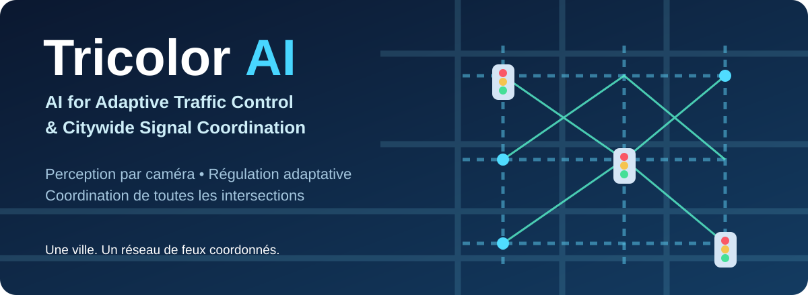

# Tricolor AI — AI for Adaptive Traffic Control & Citywide Signal Coordination

**Intelligence artificielle pour la régulation adaptative de la circulation et la coordination des feux à l’échelle des villes.**

> **Notre vision :** une ville dans laquelle les feux de circulation — qu’il s’agisse de feux tricolores traditionnels ou de robots de régulation — observent le trafic, adaptent leurs décisions et communiquent pour éviter qu’un embouteillage ne soit simplement déplacé d’un carrefour vers le suivant.

**Tricolor AI est un projet de recherche et de développement.** Les capacités décrites ci-dessous constituent des objectifs, et non les résultats d’un déploiement déjà réalisé.

## 1. Le défi : la circulation dans les villes

Dans de nombreuses villes du monde, la croissance urbaine et l’augmentation des déplacements mettent les infrastructures routières sous pression. Un embouteillage ne concerne pas uniquement les automobilistes : il retarde les transports collectifs, les livraisons, les services d’urgence et l’accès au travail, à l’école ou aux soins.

La circulation n’est pas stable tout au long de la journée. Les flux varient selon les horaires, les quartiers, les marchés, les écoles, la météo, les travaux et les incidents. Une intersection peut être presque vide pendant qu’une autre subit une longue file. Un feu qui fonctionne sans connaître cette différence peut laisser inutilement des véhicules attendre.

**Le problème dépasse chaque carrefour.** Lorsqu’un feu libère beaucoup de véhicules, ceux-ci arrivent rapidement à l’intersection suivante. Si la voie en aval est déjà saturée, la nouvelle vague de véhicules peut provoquer une remontée de file, bloquer le carrefour précédent et propager l’embouteillage à plusieurs rues.

Les recherches et les autorités de transport reconnaissent depuis longtemps ces enjeux de gestion du réseau : [Banque mondiale — transport et accès aux opportunités](https://www.worldbank.org/en/results/2026/04/01/how-better-transport-drives-opportunity) ; [FHWA — contrôle adaptatif](https://www.fhwa.dot.gov/innovation/everydaycounts/edc-1/asct.cfm).

## 2. Les systèmes de régulation qui existent déjà

| Système | Principe | Ce qu’il apporte |
| --- | --- | --- |
| **Feux à temps fixe** | Des durées et des cycles programmés à l’avance | Simple, prévisible et largement répandu |
| **Feux déclenchés par la circulation** | Des détecteurs prolongent ou interrompent certaines phases selon la demande | Une réponse locale aux véhicules présents |
| **Feux adaptatifs** | Les durées évoluent en fonction de la circulation mesurée | Une meilleure adaptation aux changements de trafic |
| **Systèmes coordonnés (SCOOT, SCATS, etc.)** | Plusieurs carrefours ajustent leur fonctionnement en réseau | Une circulation plus fluide le long de certains axes ou secteurs |
| **Robots de régulation** | Un dispositif physique transmet aux conducteurs les autorisations de passage | Une forme de signalisation visible, notamment illustrée par les robots roulage en RDC |

Le contrôle adaptatif et la coordination entre feux **ne sont pas des inventions nouvelles**. Des systèmes comme SCOOT et SCATS sont utilisés depuis de nombreuses années. Les robots roulage de la République démocratique du Congo inspirent Tricolor AI en montrant qu’un dispositif de régulation peut prendre une autre forme que le feu tricolore traditionnel.

**Tricolor AI ne cherche pas à remplacer toutes ces infrastructures physiques.** Le projet vise à rendre leur fonctionnement plus sensible à la circulation réelle et mieux coordonné à l’échelle urbaine.

Références : [FHWA — technologies existantes](https://www.fhwa.dot.gov/innovation/everydaycounts/edc-1/asct.cfm) ; [FHWA — principes et limites du contrôle adaptatif](https://www.fhwa.dot.gov/innovation/everydaycounts/edc-1/asct-faqs.cfm).

## 3. Les problèmes qui restent à résoudre

Malgré les progrès des systèmes existants, plusieurs difficultés persistent selon les villes, les équipements et les conditions locales :

1. **Des décisions parfois trop rigides :** des cycles prédéfinis réagissent mal aux variations rapides de la circulation.
2. **Une vision parfois limitée à un carrefour :** améliorer localement un feu ne garantit pas une amélioration de toute la ville.
3. **La propagation des embouteillages :** libérer davantage de véhicules peut saturer une voie qui ne dispose plus de place.
4. **La qualité des informations :** caméras et détecteurs peuvent manquer des véhicules, être masqués, tomber en panne ou nécessiter une maintenance.
5. **La diversité des équipements :** feux traditionnels, contrôleurs existants et robots de circulation n’ont pas tous les mêmes interfaces.
6. **La fiabilité opérationnelle :** toute amélioration doit rester compatible avec la sécurité des usagers, la priorité des piétons, les transitions des feux et les contraintes de terrain.
7. **L’échelle urbaine :** coordonner un corridor est plus simple que gérer un réseau entier avec des perturbations et des communications imparfaites.

Ces limites ne sont pas universelles à tous les systèmes existants : certains dispositifs adaptatifs et coordonnés répondent déjà à une partie de ces défis. La question est de rendre les solutions **fiables, compatibles et efficaces dans des conditions variées**.

## 4. Où en est la recherche en 2026 ?

### Traffic-R1 — Comprendre la circulation et coordonner les décisions

[Traffic-R1: Reinforced LLMs Bring Human-Like Reasoning to Traffic Signal Control Systems (ACL 2026)](https://aclanthology.org/2026.acl-long.995/), de Xingchen Zou et ses collègues, étudie un modèle d’intelligence artificielle spécialisé dans les décisions de signalisation. Il est entraîné dans des environnements simulés et prend en compte la coordination de plusieurs intersections.

**Fait important :** contrairement à l’idée selon laquelle toute la recherche récente resterait en laboratoire, les auteurs de Traffic-R1 **rapportent un déploiement en production** concernant plus de **55 000 conducteurs par jour**, avec une diminution moyenne des files de plus de **5 %**. Il s’agit de résultats annoncés par les auteurs, qui ne doivent pas être généralisés automatiquement à d’autres villes.

### ProcessLight — Améliorer la manière de choisir une phase

[ProcessLight: Process Supervision for Large Language Model Based Traffic Signal Control (EMNLP 2026)](https://aclanthology.org/2026.emnlp-main.1966/), de Shuaitao Zhao et ses collègues, cherche à améliorer les décisions des systèmes d’intelligence artificielle en évaluant les différentes étapes qui conduisent au choix d’un feu.

La recherche examine notamment les files d’attente, la circulation en aval et le contexte des intersections voisines. Ses évaluations publiées reposent sur des expérimentations simulées avec des données de circulation issues de réseaux réels ; elles **ne démontrent pas, à elles seules, un déploiement opérationnel sur des routes publiques**.

Code : [ProcessLight sur GitHub](https://github.com/wenzhaoabc/processlight).

### Ce que nous retenons de ces recherches

Ces publications montrent la progression de l’intelligence artificielle appliquée aux feux : elle peut tenir compte de davantage d’informations, envisager des conséquences sur les intersections voisines et améliorer ses décisions. Elles confirment aussi que la **coordination est une question centrale**, au-delà de la seule sélection du feu vert.

Tricolor AI emprunte cette **question de recherche générale**, mais n’a pas pour objectif obligatoire de reproduire des modèles qui génèrent de longs raisonnements en langage naturel.

## 5. Pourquoi les résultats de laboratoire ne sont-ils pas systématiquement déployés ?

Il serait incorrect d’affirmer que les techniques intelligentes ne sont jamais utilisées sur le terrain : des systèmes adaptatifs sont déjà en service, et Traffic-R1 fait état d’une application réelle. Cependant, **un bon résultat de simulation ne garantit pas un fonctionnement sûr et performant dans toutes les villes**.

Les difficultés de passage au terrain concernent notamment :

- **La réalité de la route :** les comportements des conducteurs, les incidents, les travaux et les changements de voie diffèrent des hypothèses d’un simulateur.
- **La perception :** les observations des caméras et des capteurs peuvent être incomplètes ou erronées.
- **La commande physique :** un ordre calculé doit respecter les contraintes du contrôleur réel, les temps de transition et le passage des piétons.
- **Les communications :** les intersections doivent rester sûres même lorsque les informations d’un voisin arrivent en retard ou disparaissent.
- **L’intégration et la maintenance :** les infrastructures installées sont diverses ; leurs coûts, leurs contraintes et leur entretien comptent autant que les performances du logiciel.
- **La validation :** un projet doit démontrer des bénéfices répétés, et non seulement réussir quelques scénarios favorables.

Les travaux récents [Sim2Signal (2026)](https://arxiv.org/abs/2609.01676) analysent précisément l'écart entre simulation et terrain. Une [étude de déploiement sur quatre intersections à Chattanooga (2026)](https://www.mdpi.com/2073-8994/18/10/1659) illustre également l’importance de la compatibilité avec les équipements, les piétons et les règles de sécurité, sans revendiquer une amélioration comparative du trafic lors de ces essais.

## 6. Notre idée : Tricolor AI

**Et si les feux d’une ville cessaient de fonctionner comme des dispositifs isolés et commençaient à agir comme un réseau coordonné ?**

Nous imaginons un système dans lequel chaque intersection **observe**, **s’adapte** et **communique** :

**Observer.** Des caméras permettent d’estimer le nombre de véhicules, les files d’attente, les temps d’attente et la congestion dans chaque direction.

**S’adapter.** Au lieu de suivre uniquement un programme fixe, le système ajuste les autorisations de passage à la situation présente, sans compromettre la sécurité.

**Communiquer.** Lorsqu’un carrefour laisse passer des véhicules, les intersections suivantes sont informées du trafic qui pourrait arriver. Elles peuvent tenir compte de cette information avant de choisir leur propre régulation.

**Éviter de déplacer le problème.** Une intersection ne devrait pas chercher à vider ses files si la route suivante est déjà pleine. La fluidité d’une rue doit être évaluée avec celle des rues qui la précèdent et qui la suivent.

**Fonctionner avec différents équipements.** Tricolor AI doit pouvoir s’intégrer aux feux classiques et, lorsque les interfaces et les autorisations le permettent, aux robots de régulation de la circulation. Les robots roulage de la RDC constituent un exemple d’application possible, **pas une limite géographique du projet**.

**Grandir avec la ville.** L’objectif est de commencer par une intersection, puis plusieurs intersections voisines, des corridors et enfin un réseau urbain entier.

L’idée centrale n’est pas de donner un modèle d’intelligence artificielle à chaque feu simplement pour remplacer une formule existante. **La valeur à démontrer est la capacité du système complet à voir la circulation, à prendre des décisions adaptées et à réduire les effets négatifs entre carrefours.**

## 7. Objectif final

Construire une plateforme universelle de régulation de la circulation qui transforme les feux tricolores et les robots de signalisation en **un réseau intelligent et coordonné à l’échelle d’une ville**, pour :

- réduire les embouteillages, les files d’attente et les arrêts inutiles ;
- mieux répartir les autorisations de passage selon la circulation ;
- anticiper les véhicules qui arrivent depuis les intersections voisines ;
- limiter les congestions qui se propagent d’une intersection à l’autre ;
- améliorer la régularité des déplacements et l’utilisation des routes existantes ;
- assurer un fonctionnement local sûr même en cas de problème de communication ;
- faciliter l’adaptation à différents pays, types de routes et équipements.

Ces résultats représentent **les objectifs à vérifier par des mesures**, et non des performances déjà obtenues par Tricolor AI.

## 8. Première feuille de route

| Étape | Ce que nous voulons démontrer |
| --- | --- |
| **1. Observer** | Estimer correctement les véhicules et les files à partir d’images de caméras |
| **2. Adapter** | Faire mieux qu’un feu à temps fixe sur une intersection, en conservant des règles de sécurité |
| **3. Communiquer** | Échanger des informations utiles entre deux intersections |
| **4. Coordonner** | Vérifier que les décisions de deux carrefours réduisent les files sans congestionner la voie aval |
| **5. Étendre** | Tester la coordination d’un corridor puis d’un réseau urbain plus large |
| **6. Vérifier le terrain** | Étudier la compatibilité des équipements, la robustesse de la perception et les contraintes de déploiement |

Les évaluations devront comparer des feux fixes, des méthodes adaptatives existantes, une régulation intelligente indépendante et une régulation coordonnée. Les résultats seront mesurés notamment par les temps d’attente, les durées des trajets, les longueurs de files, le nombre de véhicules servis et les remontées de congestion.

## 9. Recherche, références et ressources

1. **Federal Highway Administration.** [Adaptive Signal Control Technology](https://www.fhwa.dot.gov/innovation/everydaycounts/edc-1/asct.cfm). Référence institutionnelle sur les méthodes adaptatives existantes, dont SCOOT et SCATS.
2. **Federal Highway Administration.** [Adaptive Signal Control FAQs](https://www.fhwa.dot.gov/innovation/everydaycounts/edc-1/asct-faqs.cfm). Contraintes de détection, communication, coût et maintenance.
3. **Zou et al. (2026).** [Traffic-R1: Reinforced LLMs Bring Human-Like Reasoning to Traffic Signal Control Systems](https://aclanthology.org/2026.acl-long.995/). *ACL 2026*.
4. **Zhao et al. (2026).** [ProcessLight: Process Supervision for Large Language Model Based Traffic Signal Control](https://aclanthology.org/2026.emnlp-main.1966/). *EMNLP 2026*.
5. **Rafi et al. (2026).** [Sim2Signal: Sim-to-Real Benchmarks for Traffic Signal Control](https://arxiv.org/abs/2609.01676).
6. **Kumarasamy et al. (2026).** [Field Implementation and Operational Validation of a Decentralized Graph-Based Multi-Agent Reinforcement Learning Traffic-Signal Controller on a Smart Corridor](https://www.mdpi.com/2073-8994/18/10/1659).
7. **World Bank (2026).** [Moving People, Creating Jobs: How Better Transport Drives Opportunity](https://www.worldbank.org/en/results/2026/04/01/how-better-transport-drives-opportunity).

---

**Projet :** Tricolor AI  
**Dépôt :** https://github.com/kennedy-kitoko/Tricolor-AI  
**Statut :** conception et recherche — aucun résultat de déploiement revendiqué.
